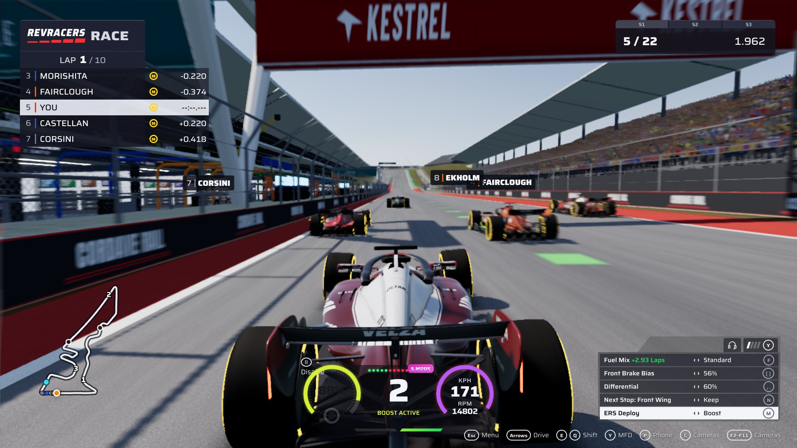
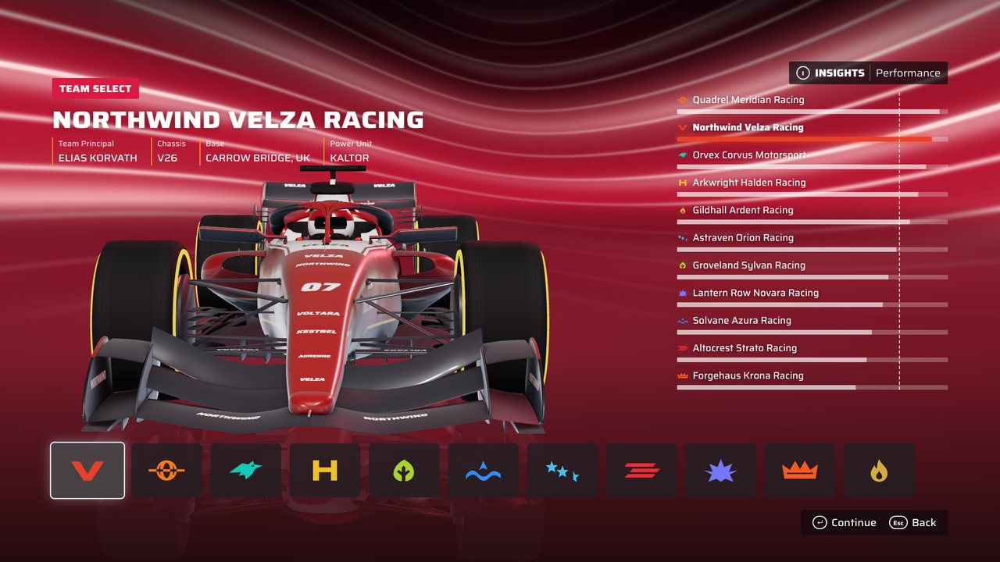
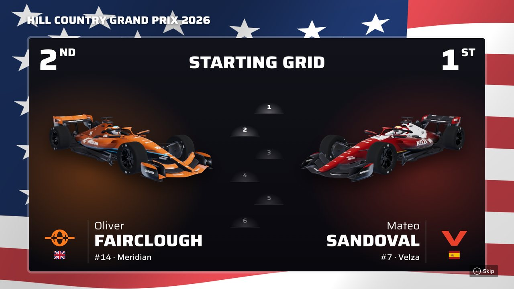
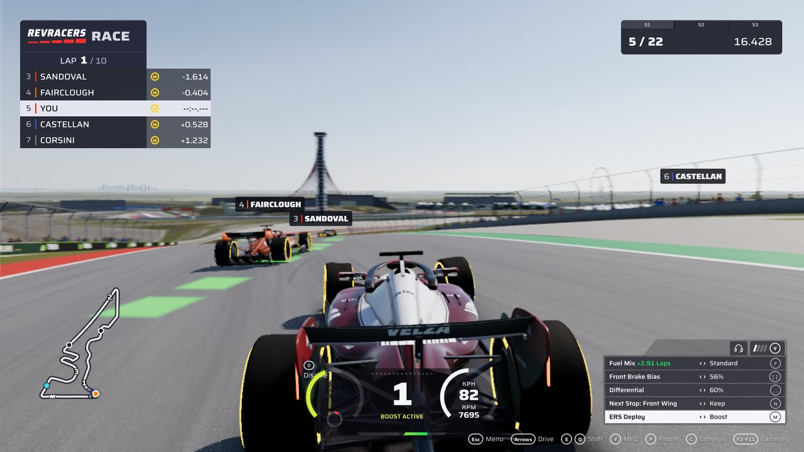
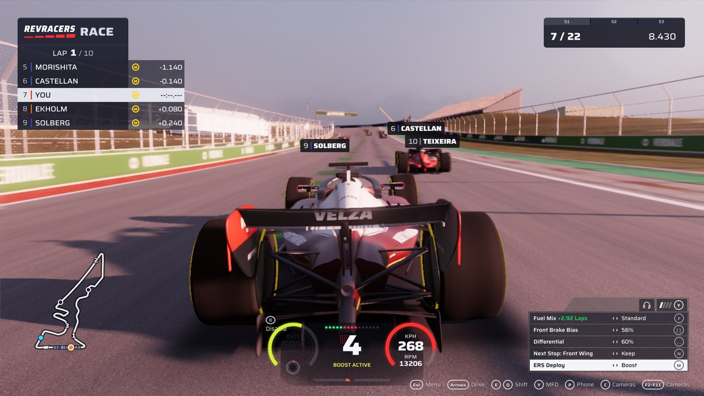
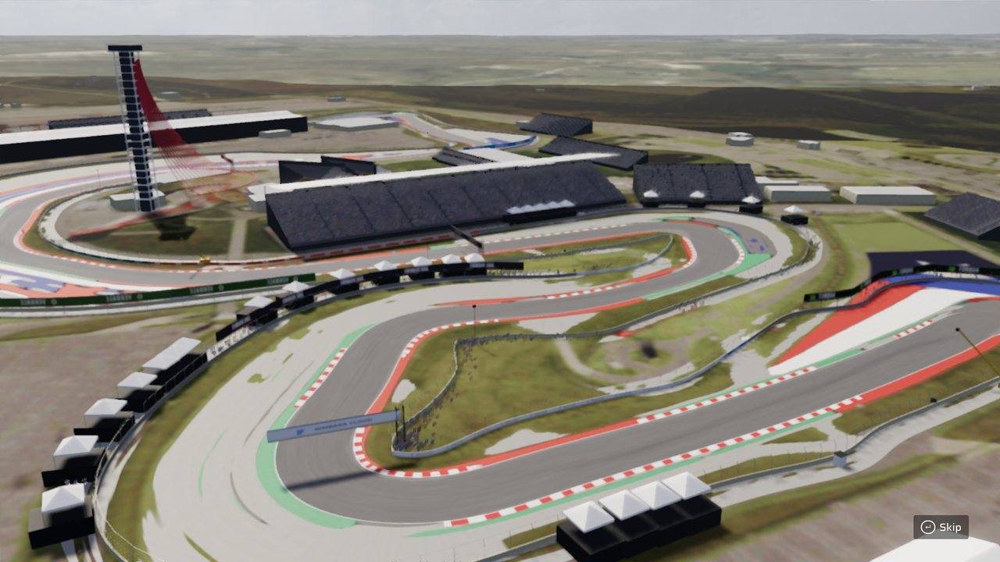
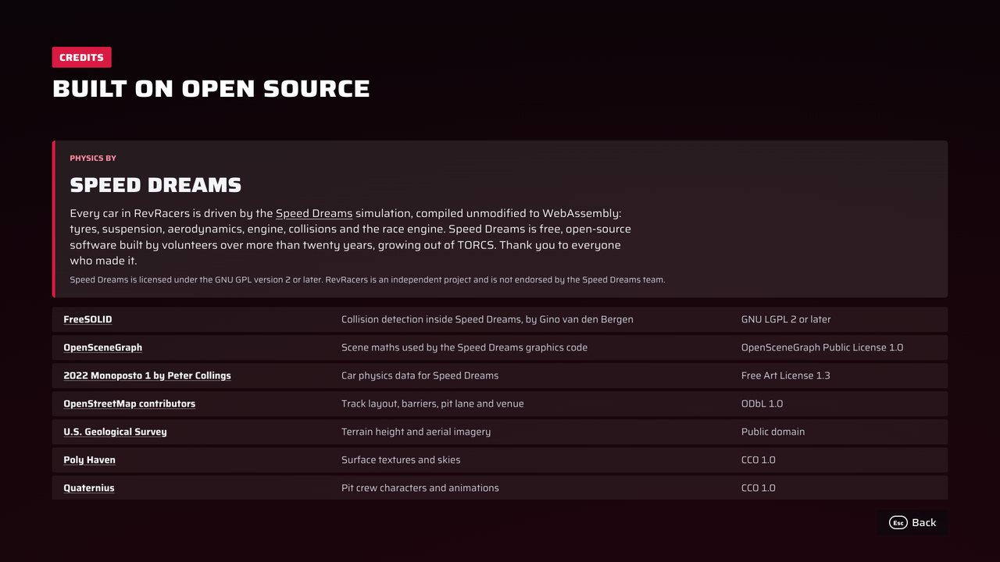

<div align="center">

<picture>
  <source media="(prefers-color-scheme: dark)" srcset="docs/readme/logo-dark.svg">
  
</picture>

**Open-wheel racing in your browser, on a real simulator.**

[Speed Dreams](https://www.speed-dreams.net/) physics compiled to WebAssembly · three.js WebGPU graphics · 22-car AI field · weather · strategy · race control



</div>

## Built on Speed Dreams

Every car in RevRacers is driven by **[Speed Dreams](https://www.speed-dreams.net/)**, the free and open-source motorsport simulator. Its tyre model, suspension, aerodynamics, engine, gearbox, collisions, track model and race engine run in your browser, compiled **unmodified** from the Speed Dreams C++ sources to WebAssembly. Our camera, lighting and model-loading code also started as ports of Speed Dreams' `osggraph` renderer.

Speed Dreams is the work of a volunteer community over more than twenty years, growing out of TORCS and RARS before it. RevRacers is only possible because they built a simulator this good and shared it under the GPL. Thank you.

RevRacers is an independent project and is not endorsed by the Speed Dreams team. If you enjoy the driving, go and try [Speed Dreams](https://www.speed-dreams.net/) itself.

## Features

- **A real simulator.** Speed Dreams' `simuv5` physics at its native step rate: load transfer, tyre temperature and wear, aero, fuel burn, kerbs, collisions and damage.
- **A full race weekend.** One-lap qualifying shootout or Q1 to Q3, a 22-car grid, standing or rolling starts, and a pre-race build-up that films the real grid.
- **AI rivals** that follow a calibrated racing line, defend, overtake, pit and run their own tyre strategies.
- **Strategy.** Soft, medium, hard, intermediate and wet tyres, tyre wear, fuel load and mix, and 2026-style energy recovery and deployment.
- **Race control.** Stewards and time penalties, safety car, virtual safety car, red flags and yellow flags.
- **Weather and light.** Dawn to night, cloud cover, and rain with a drying line.
- **Damage you can see.** Impact-based wing and suspension damage, punctures, flat spots and pit-stop wing changes.
- **Flashback and replays.** Rewind a mistake, watch an instant replay, and get a reel of your overtakes when you win.
- **Your phone as a wheel.** Press <kbd>P</kbd>, scan the QR code and tilt to steer. No app, no install; it connects over WebRTC on your local network with about one frame of delay.
- **Driver profiles.** Accounts, team choice, personal bests, sector times and lap history.
- **Eleven fictional teams** with their own cars, liveries and drivers, on a full-scale circuit built from OpenStreetMap and USGS lidar.

## Gallery

<table>
  <tr>
    <td></td>
    <td></td>
  </tr>
  <tr>
    <td></td>
    <td></td>
  </tr>
  <tr>
    <td></td>
    <td></td>
  </tr>
</table>

## Getting started

RevRacers runs in desktop Chrome with WebGPU enabled.

You need:

- [Node.js](https://nodejs.org/) 24.22 and [pnpm](https://pnpm.io/) 12
- [Git LFS](https://git-lfs.com/) for the car, track and music assets
- [Emscripten](https://emscripten.org/) (`em++` on your `PATH`, for example `brew install emscripten`) to compile Speed Dreams

```sh
git lfs install
git clone https://github.com/prayanshchh/revracers.git
cd revracers
pnpm install
pnpm --filter ./apps/client exec vite
```

Then open <http://localhost:5173/drive.html>. The first start compiles Speed Dreams to WebAssembly, which takes a few minutes; later starts reuse the build.

For a production build, run `pnpm run build`; the game is written to `apps/client/dist`.

### Controls

| Key                                        | Action                         |
| ------------------------------------------ | ------------------------------ |
| Arrow keys                                 | Throttle, brake and steering   |
| <kbd>E</kbd> / <kbd>Q</kbd>                | Shift up / down                |
| <kbd>Y</kbd>                               | Multi-function display         |
| <kbd>R</kbd>                               | Replay and flashback           |
| <kbd>C</kbd>, <kbd>F2</kbd>–<kbd>F11</kbd> | Cameras                        |
| <kbd>P</kbd>                               | Connect your phone as a wheel  |
| <kbd>Esc</kbd>                             | Pause menu, setup and settings |

## How it works

```
engine/speed-dreams   Speed Dreams sources and data, vendored unmodified
engine/src            C++ glue: race loop, AI, tyres, energy, weather, stewards
tools/build-engine.mjs  compiles both to WebAssembly with Emscripten
apps/client           three.js WebGPU renderer, HUD, menus, sound and music
apps/api              accounts and lap records (Hono + PostgreSQL / PGlite)
content               cars, track, music and calibration data
tools                 Blender and Python pipelines that generate cars and the circuit
tests                 Vitest and Playwright suites
```

The browser loads the WebAssembly engine, which steps the Speed Dreams simulation for every car. Each frame the client reads car positions, wheel states and race status from the engine and draws them with three.js on WebGPU. Inputs from the keyboard or phone go straight into Speed Dreams' own human-driver input path.

### Checks and tests

```sh
pnpm run check      # formatting, lint, types, unused code, duplicates
pnpm run test       # Vitest, including engine tests against the WebAssembly build
pnpm run test:e2e   # Playwright browser tests
```

## Credits and licence

RevRacers code is free software under the [GNU General Public License v3.0 or later](LICENSE). It includes Speed Dreams, which is licensed under the GNU GPL v2 or later.

Original art and branding (the RevRacers name and logo, car bodies, liveries, team identities and track scenery) are © Prayansh Chhablani, all rights reserved. Third-party assets keep their own licences: car physics data under the Free Art License, map data © OpenStreetMap contributors under the ODbL, CC0 textures, skies and characters, and music under CC0 and the Pixabay Content License. See **[CREDITS.md](CREDITS.md)** for the full list; the same credits are in the game under **Credits**.

RevRacers is a fan-made game. All teams, drivers, sponsors and venues are fictional, and it is not affiliated with or endorsed by any racing series, team, circuit, car maker or game publisher.
